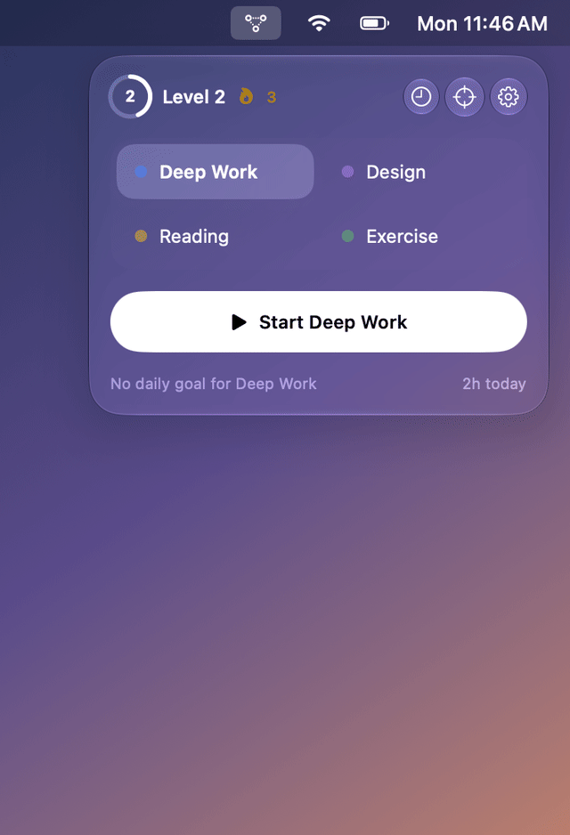

<div align="center">

# Consta

**Focus sessions that live in your menu bar.**

Pick what you're working on, press Start, and watch the time add up. Daily goals, streaks, XP and badges make the work feel like progress.

[**Download for macOS**](https://github.com/banstack/consta/releases/latest) · [Build from source](#build-from-source) · [Contribute](#contributing)



</div>

## Features

- **One click to start.** Choose a label and a live timer appears next to the menu bar icon. Pause, resume and stop without leaving what you're doing.
- **History.** Every past session by day, with its note and XP, and the last seven days at a glance.
- **Goals and streaks.** Daily or weekly time targets per label.
- **Levels and badges.** Earn 1 XP per focused minute and bonuses for meeting goals, level up, and unlock nine badges along the way.
- **Labels.** Pick a color for each label from a calm ten-color palette.
- **Native and private.** Built with SwiftUI and Liquid Glass. Everything is stored on your Mac with SwiftData. There's no account and no server.

## Install

Download the latest `Consta-<version>.dmg` from [Releases](https://github.com/banstack/consta/releases/latest), open it, and drag Consta to Applications. Consta needs macOS 27 or later.

Releases are signed and notarized by Apple, so Consta opens like any other app. Releases up to v0.2.0 weren't notarized: if macOS blocks one of those on first launch, open **System Settings › Privacy & Security** and click **Open Anyway** once.

## Build from source

You need Xcode with the macOS 27 SDK.

```bash
git clone https://github.com/banstack/consta.git
cd consta
swift run Consta
```

You can also open `Package.swift` in Xcode and run the `Consta` scheme. Consta has no Dock icon, so look for the constellation icon in the menu bar.

## Contributing

Issues and pull requests are welcome. Run `swift test` before opening a PR.

### Package a DMG

```bash
scripts/make-dmg.sh
```

This builds a release `Consta.app` (bundle id `com.banstack.consta`, menu bar only, with an app icon drawn by `scripts/make-icon.swift`) and wraps it in `dist/Consta-<version>.dmg` with a shortcut to Applications. `scripts/build-app.sh` builds just the app.

Without signing credentials, the app is ad-hoc signed. It runs, but on someone else's Mac the first launch is blocked: they open **System Settings › Privacy & Security** and click **Open Anyway** once. To get a DMG that opens without a warning, sign with a Developer ID and notarize it (both need the Apple Developer Program):

```bash
xcrun notarytool store-credentials consta   # once: Apple ID, team ID, app-specific password
CONSTA_SIGN_IDENTITY="Developer ID Application: Your Name (TEAMID)" \
CONSTA_NOTARY_PROFILE=consta \
scripts/make-dmg.sh
```

#### Releases

Pushing a tag like `v0.1.0` runs `.github/workflows/release.yml`, which tests, builds the DMG and attaches it to a GitHub release. It signs and notarizes when these repository secrets are set and builds an unsigned DMG otherwise. With a certificate but no notarization credentials the build fails, since a signed but unnotarized DMG is still blocked by Gatekeeper.

| Secret | What it is |
| --- | --- |
| `MACOS_CERTIFICATE` | Your Developer ID Application certificate exported as .p12, base64-encoded (`base64 -i cert.p12 \| pbcopy`) |
| `MACOS_CERTIFICATE_PASSWORD` | The .p12 export password |
| `MACOS_SIGN_IDENTITY` | Optional. The identity name, e.g. `Developer ID Application: Your Name (TEAMID)`. By default the workflow uses the Developer ID identity in `MACOS_CERTIFICATE`. |
| `APPLE_ID`, `APPLE_TEAM_ID`, `APPLE_APP_PASSWORD` | The Apple ID, team ID and app-specific password used for notarization |

### Scripted UI runs

Debug builds include a small driver for exercising the UI and taking screenshots without Accessibility or Screen Recording permission. It uses an in-memory store, so your data isn't touched. Commands are read from stdin, one per line (`open`, `click X Y`, `type TEXT`, `key return`, `sleep SECONDS`, `shot PATH`, `sample`, `dump`, `quit`; see `Sources/Consta/Support/DebugDriver.swift`):

```bash
printf 'open\nsleep 1\nshot /tmp/idle.png\nquit\n' | CONSTA_DRIVER=1 swift run Consta
```

### Project layout

| Path | What's there |
| --- | --- |
| `Sources/ConstaKit` | Pure game logic: level curve, XP rules, goal progress and streaks, badges, and the `Progression` evaluator that works out what a session earns. No UI or persistence, fully unit-tested. |
| `Sources/Consta` | The SwiftUI menu bar app. `Models/` holds the SwiftData models, `Support/` the session stopwatch and persistence helpers, `Views/` one file per screen. |
| `Tests/ConstaKitTests` | Swift Testing tests for `ConstaKit`. |
| `Packaging`, `scripts` | The app bundle's Info.plist and the app, icon and DMG build scripts. |
