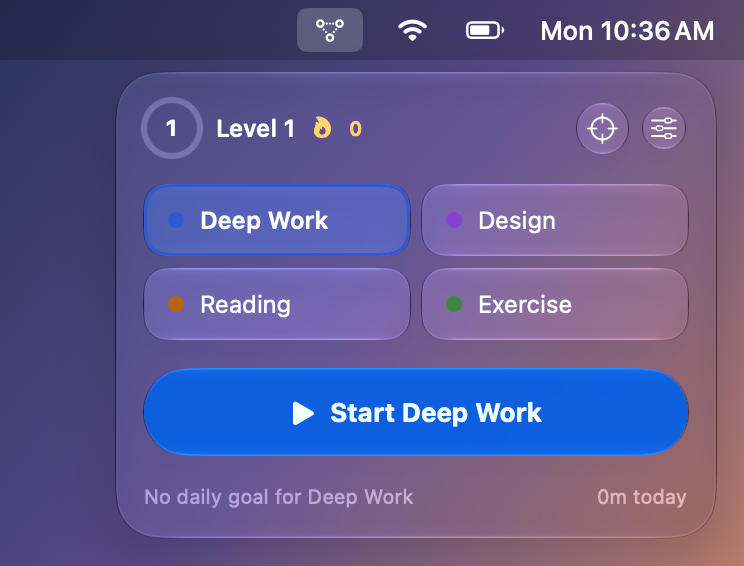
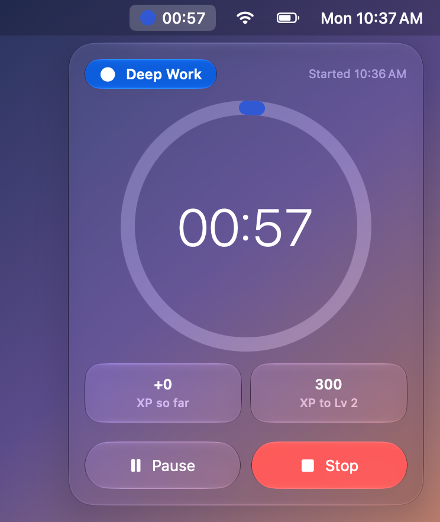
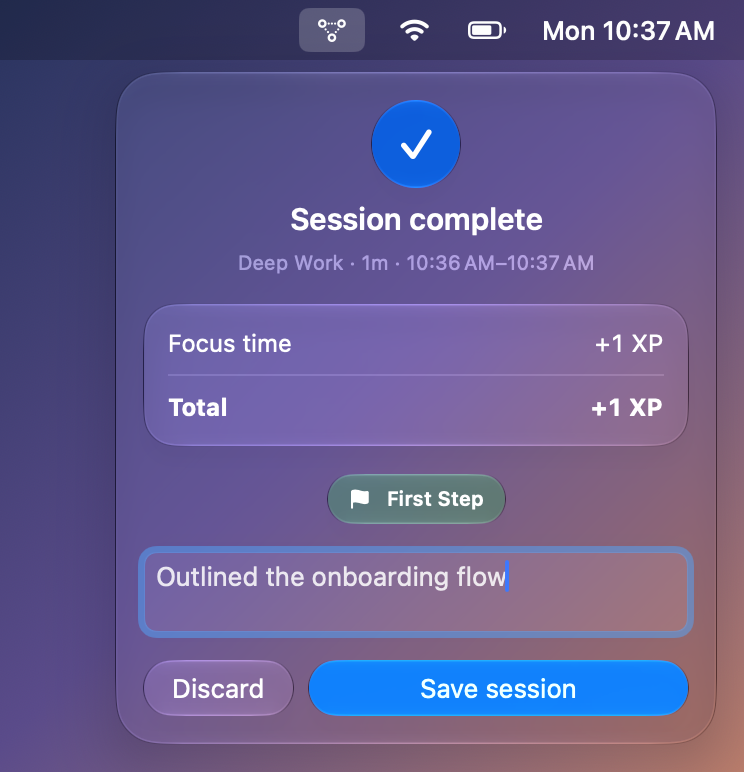
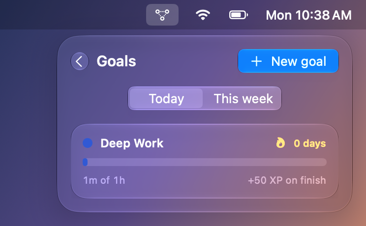
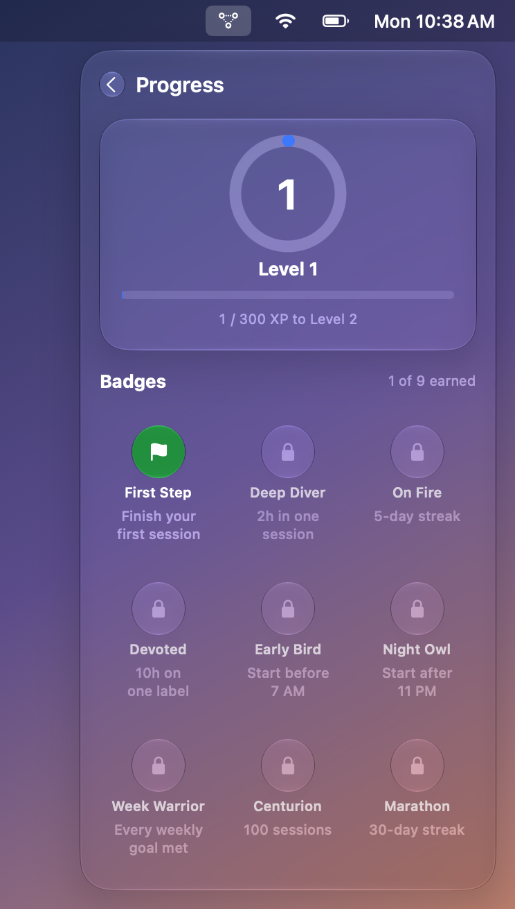
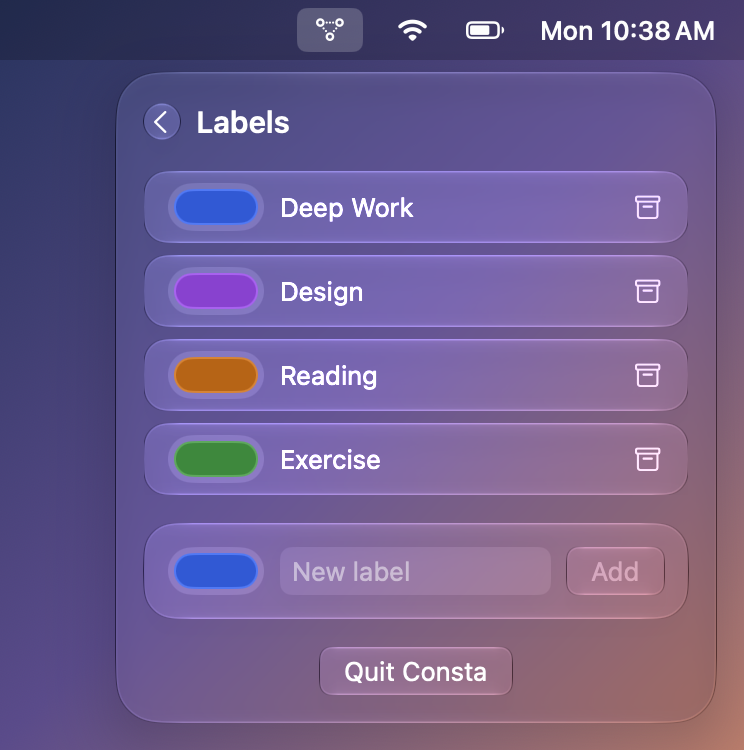

# Consta

A macOS menu bar app for tracking focus sessions by label, with goals, XP, levels and badges to make productivity a bit of a game. The successor to [insession](https://github.com/banstack/insession), rebuilt as a native SwiftUI app with Apple's Liquid Glass design.

## Features

- **Sessions from the menu bar.** Pick a label, press Start, and the live timer shows next to the menu bar icon. Pause, resume, stop.
- **Labels.** Color-coded tags for what you're working on (Deep Work, Reading, …). The four you used most recently are one click away.
- **Goals.** Daily or weekly time targets per label, with streaks.
- **XP and levels.** 1 XP per focused minute, +50 XP for a daily goal, +200 XP for a weekly goal. Level 1 → 2 takes 300 XP and each level takes 250 XP more than the last.
- **Badges.** Nine achievements, from First Step to a 30-day Marathon streak.
- **Private.** Everything is stored locally with SwiftData. No account, no server.

Mockups of every screen live in the [Consta Screens gallery](https://claude.ai/artifact/1cqrPNBm5Tqvim7gr6Sojm).

## Screenshots

| Idle | Running | Session complete |
| --- | --- | --- |
|  |  |  |

| Goals | Progress | Labels |
| --- | --- | --- |
|  |  |  |

These were captured from the running app with the debug driver (below). The popover and menu bar item are the app's real views; the strip of menu bar and the backdrop behind them are drawn by the driver.

## Requirements

- macOS 27 or later
- Xcode with the macOS 27 SDK

## Run it

```bash
swift run Consta
```

Or open `Package.swift` in Xcode and run the `Consta` scheme. The app has no Dock icon; look for the constellation icon in the menu bar.

## Tests

```bash
swift test
```

### Scripted UI runs

Debug builds include a small driver for exercising the UI and taking screenshots without Accessibility or Screen Recording permission. It uses an in-memory store, so your data isn't touched. Commands are read from stdin, one per line (`open`, `click X Y`, `type TEXT`, `key return`, `sleep SECONDS`, `shot PATH`, `dump`, `quit`; see `Sources/Consta/Support/DebugDriver.swift`):

```bash
printf 'open\nsleep 1\nshot /tmp/idle.png\nquit\n' | CONSTA_DRIVER=1 swift run Consta
```

## Layout

| Path | What's there |
| --- | --- |
| `Sources/ConstaKit` | Pure game logic: level curve, XP rules, goal progress and streaks, badges, and the `Progression` evaluator that works out what a session earns. No UI or persistence, fully unit-tested. |
| `Sources/Consta` | The SwiftUI menu bar app. `Models/` holds the SwiftData models, `Support/` the session stopwatch and persistence helpers, `Views/` one file per screen. |
| `Tests/ConstaKitTests` | Swift Testing tests for `ConstaKit`. |
